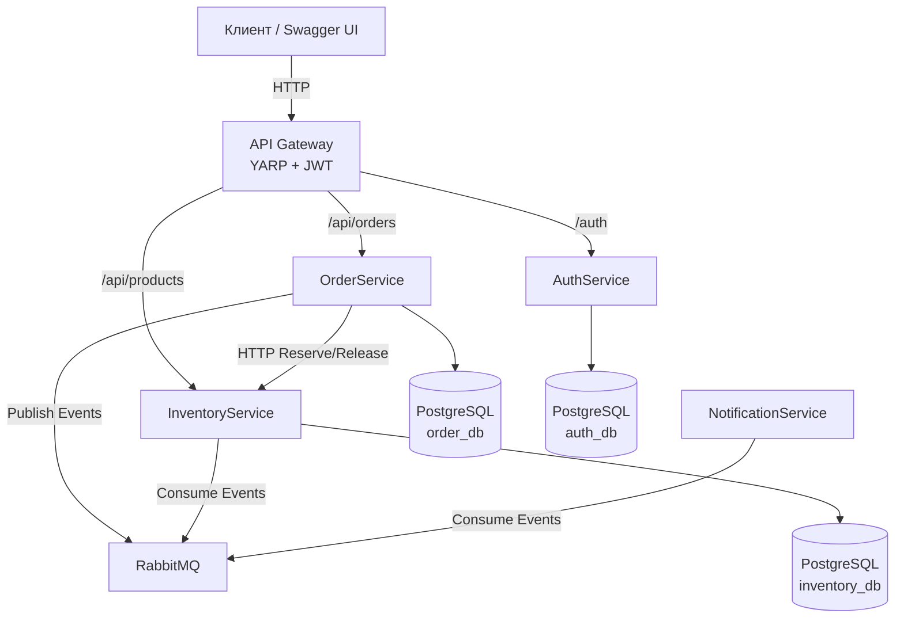

# Order Platform — Microservices Architecture

Учебный проект, демонстрирующий полноценную микросервисную архитектуру с единой точкой входа, асинхронным обменом сообщениями, разграничением ролей и изолированными базами данных.

## Архитектура

Проект построен по принципам Domain-Driven Design (DDD) и Clean Architecture. Каждый сервис изолирован, имеет собственную базу данных и общается с другими сервисами либо синхронно (через HTTP), либо асинхронно (через брокер сообщений).

### Сервисы

| Сервис | Порт (внутренний) | Зона ответственности | База данных |
|---|---|---|---|
| **ApiGateway** | 8080 (внешний) | Единая точка входа, маршрутизация (YARP), валидация JWT, агрегация Swagger UI. | — |
| **OrderService** | 8080 | Управление заказами, оркестрация резервирования товаров, публикация событий. | order_db |
| **InventoryService** | 8080 | Управление каталогом товаров и складскими остатками (резервы, списание). | inventory_db |
| **AuthService** | 8080 | Аутентификация, выдача JWT (Access + Refresh), управление пользователями и ролями. | auth_db |
| **NotificationService** | — | Асинхронная обработка событий (имитация отправки Email/Push). | — |
| **RabbitMQ** | 5672 / 15672 | Брокер сообщений (event-driven). | — |

## Технологический стек

- **Платформа:** .NET 10 (C#)
- **Фреймворк:** ASP.NET Core Web API
- **Базы данных:** PostgreSQL 17 + Entity Framework Core 10
- **API Gateway:** YARP (Yet Another Reverse Proxy)
- **Брокер сообщений:** RabbitMQ + MassTransit 8.4.1
- **Аутентификация:** JWT (HS256), HttpOnly Cookies, Refresh Tokens
- **Архитектурные паттерны:** Clean Architecture, CQRS (MediatR), Event-Driven Architecture, Repository/Unit of Work (через EF Core)
- **Инфраструктура:** Docker, Docker Compose

## Ключевые бизнес-потоки

### 1. Создание заказа (Saga / Orchestration)

1. Клиент отправляет POST /api/orders через Gateway.
2. **OrderService** валидирует запрос и запрашивает актуальные данные товаров у **InventoryService**.
3. **OrderService** вызывает **InventoryService** для резервирования остатков (ReserveStock).
4. **OrderService** сохраняет заказ в БД и публикует событие OrderCreatedEvent в RabbitMQ.
5. **NotificationService** ловит событие и "отправляет" уведомление клиенту.

### 2. Завершение заказа

1. Администратор отправляет POST /api/orders/{id}/complete.
2. **OrderService** меняет статус на Done и публикует OrderCompletedEvent.
3. **InventoryService** ловит событие и окончательно списывает зарезервированный товар со склада.

### 3. Отмена заказа

1. Клиент отправляет POST /api/orders/{id}/cancel.
2. **OrderService** меняет статус на Cancelled и вызывает **InventoryService** для снятия резерва (ReleaseStock).

## Безопасность

- **Аутентификация:** Реализована в AuthService с использованием JWT. Поддерживается передача токена как через заголовок Authorization: Bearer, так и через HttpOnly Cookie (для браузерных клиентов).
- **Авторизация:** Ролевая модель (User / Admin).
- **API Gateway:** Валидирует JWT на своей стороне. Если токен валиден, Gateway извлекает UserId и Roles и передает их внутренним сервисам через заголовки X-User-Id и X-User-Roles. Внутренние сервисы доверяют этим заголовкам (так как порты наружу не проброшены) и используют кастомный HeaderAuthenticationHandler.

## Запуск проекта

Существует два способа запуска проекта в зависимости от ваших целей.

### Вариант 1: Продакшн-подобный (из готовых образов)

Базы данных и сервисы поднимаются из готовых образов.

# Перейдите в директорию инфраструктуры
```cd repos/order-platform-infra```

Запустите контейнеры
```docker compose docker-compose.yml up -d```

### Вариант 2: Тестирование локальных изменений (сборка из Dockerfile)

Используется во время разработки, когда нужно протестировать изменения до коммита. Docker Compose собирает образы из локальных исходников (Dockerfile).

**Важно:** Все репозитории с сервисами должны быть склонированы в одну папку (рядом с order-platform-infra).

# Перейдите в директорию инфраструктуры
```cd repos/order-platform-infra```
 Запустите сборку и поднятие контейнеров
```docker compose -f docker-compose.test.yml up --build -d```

### Доступные интерфейсы после запуска:

- **Агрегированный Swagger UI:** [http://localhost:8080/swagger](http://localhost:8080/swagger)
- **RabbitMQ Management:** [http://localhost:15672](http://localhost:15672) (логин: guest, пароль: guest)

### Тестовые учетные записи (Seed):

При первом запуске AuthService автоматически создает администратора:

- **Email:** admin@admin
- **Пароль:** admin@admin

*(Вы можете зарегистрировать обычного пользователя через POST /auth/register в Swagger).*

# Структура репозиториев
### Проект разделен на независимые репозитории (полирепозиторий):
  - [order-platform-infra](https://github.com/sergiuscain/order-platform-infra) (текущий) — Docker Compose, конфигурация инфраструктуры, README.
  - [OrderService](https://github.com/sergiuscain/OrderService)  — сервис заказов (Clean Architecture).
  - [InventoryService](https://github.com/sergiuscain/InventoryService)  — сервис склада (Clean Architecture).
  - [AuthService](https://github.com/sergiuscain/AuthService)  — сервис аутентификации (Clean Architecture).
  - [ApiGateway](https://github.com/sergiuscain/ApiGateway)  — шлюз на YARP.
  - [NotificationService](https://github.com/sergiuscain/NotificationService)  — консьюмер событий.

# Скриншоты


