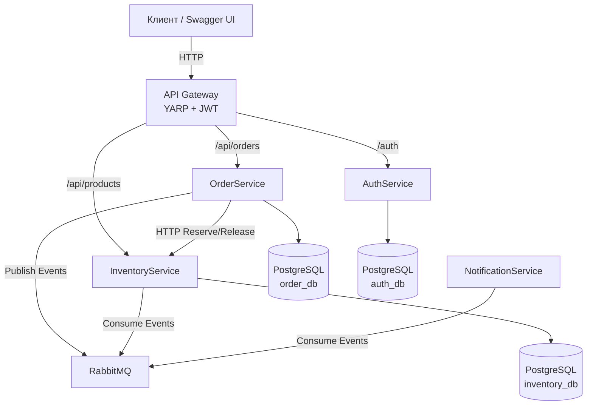

<h1>Order Platform — Microservices Architecture</h1>

Учебный проект, демонстрирующий полноценную микросервисную архитектуру с единой точкой входа, асинхронным обменом сообщениями, разграничением ролей и изолированными базами данных.

<h2>📐 Архитектура</h2>

Проект построен по принципам Domain-Driven Design (DDD) и Clean Architecture. Каждый сервис изолирован, имеет собственную базу данных и общается с другими сервисами либо синхронно (через HTTP), либо асинхронно (через брокер сообщений).

<h3>Сервисы</h3>
<table>
  <thead>
    <tr>
      <th>Сервис</th>
      <th>Порт (внутренний)</th>
      <th>Зона ответственности</th>
      <th>База данных</th>
    </tr>
  </thead>
  <tbody>
    <tr>
      <td><b>ApiGateway</b></td>
      <td>8080 (внешний)</td>
      <td>Единая точка входа, маршрутизация (YARP), валидация JWT, агрегация Swagger UI.</td>
      <td>—</td>
    </tr>
    <tr>
      <td><b>OrderService</b></td>
      <td>8080</td>
      <td>Управление заказами, оркестрация резервирования товаров, публикация событий.</td>
      <td>order_db</td>
    </tr>
    <tr>
      <td><b>InventoryService</b></td>
      <td>8080</td>
      <td>Управление каталогом товаров и складскими остатками (резервы, списание).</td>
      <td>inventory_db</td>
    </tr>
    <tr>
      <td><b>AuthService</b></td>
      <td>8080</td>
      <td>Аутентификация, выдача JWT (Access + Refresh), управление пользователями и ролями.</td>
      <td>auth_db</td>
    </tr>
    <tr>
      <td><b>NotificationService</b></td>
      <td>—</td>
      <td>Асинхронная обработка событий (имитация отправки Email/Push).</td>
      <td>—</td>
    </tr>
    <tr>
      <td><b>RabbitMQ</b></td>
      <td>5672 / 15672</td>
      <td>Брокер сообщений (event-driven).</td>
      <td>—</td>
    </tr>
  </tbody>
</table>

<h2>🛠 Технологический стек</h2>
<ul>
  <li><b>Платформа:</b> .NET 10 (C#)</li>
  <li><b>Фреймворк:</b> ASP.NET Core Web API</li>
  <li><b>Базы данных:</b> PostgreSQL 17 + Entity Framework Core 10</li>
  <li><b>API Gateway:</b> YARP (Yet Another Reverse Proxy)</li>
  <li><b>Брокер сообщений:</b> RabbitMQ + MassTransit 8.4.1</li>
  <li><b>Аутентификация:</b> JWT (HS256), HttpOnly Cookies, Refresh Tokens</li>
  <li><b>Архитектурные паттерны:</b> Clean Architecture, CQRS (MediatR), Event-Driven Architecture, Repository/Unit of Work (через EF Core)</li>
  <li><b>Инфраструктура:</b> Docker, Docker Compose</li>
</ul>

<h2>🔄 Ключевые бизнес-потоки</h2>

<h3>1. Создание заказа (Saga / Orchestration)</h3>
<ol>
  <li>Клиент отправляет POST /api/orders через Gateway.</li>
  <li><b>OrderService</b> валидирует запрос и запрашивает актуальные данные товаров у <b>InventoryService</b>.</li>
  <li><b>OrderService</b> вызывает <b>InventoryService</b> для резервирования остатков (ReserveStock).</li>
  <li><b>OrderService</b> сохраняет заказ в БД и публикует событие OrderCreatedEvent в RabbitMQ.</li>
  <li><b>NotificationService</b> ловит событие и "отправляет" уведомление клиенту.</li>
</ol>

<h3>2. Завершение заказа</h3>
<ol>
  <li>Администратор отправляет POST /api/orders/{id}/complete.</li>
  <li><b>OrderService</b> меняет статус на Done и публикует OrderCompletedEvent.</li>
  <li><b>InventoryService</b> ловит событие и окончательно списывает зарезервированный товар со склада.</li>
</ol>

<h3>3. Отмена заказа</h3>
<ol>
  <li>Клиент отправляет POST /api/orders/{id}/cancel.</li>
  <li><b>OrderService</b> меняет статус на Cancelled и вызывает <b>InventoryService</b> для снятия резерва (ReleaseStock).</li>
</ol>

<h2>🔐 Безопасность</h2>
<ul>
  <li><b>Аутентификация:</b> Реализована в AuthService с использованием JWT. Поддерживается передача токена как через заголовок Authorization: Bearer, так и через HttpOnly Cookie (для браузерных клиентов).</li>
  <li><b>Авторизация:</b> Ролевая модель (User / Admin).</li>
  <li><b>API Gateway:</b> Валидирует JWT на своей стороне. Если токен валиден, Gateway извлекает UserId и Roles и передает их внутренним сервисам через заголовки X-User-Id и X-User-Roles. Внутренние сервисы доверяют этим заголовкам (так как порты наружу не проброшены) и используют кастомный HeaderAuthenticationHandler.</li>
</ul>

<h2>🚀 Запуск проекта</h2>

Существует два способа запуска проекта в зависимости от ваших целей.

<h3>Вариант 1: Продакшн-подобный (из готовых образов)</h3>

Используется, если образы уже собраны и опубликованы (например, в GitHub Container Registry). Базы данных и сервисы поднимаются из готовых образов.

<pre><code># Перейдите в директорию инфраструктуры
cd repos/order-platform-infra

Запустите контейнеры
docker compose -f docker-compose.yml up -d</code></pre>

<h3>Вариант 2: Тестирование локальных изменений (сборка из Dockerfile)</h3>

Используется во время разработки, когда нужно протестировать изменения до коммита. Docker Compose собирает образы из локальных исходников (Dockerfile).

<b>Важно:</b> Все репозитории с сервисами должны быть склонированы в одну папку (рядом с order-platform-infra).

<pre><code># Перейдите в директорию инфраструктуры
cd repos/order-platform-infra
 Запустите сборку и поднятие контейнеров
docker compose -f docker-compose.test.yml up --build -d</code></pre>

<h3>Доступные интерфейсы после запуска:</h3>
<ul>
  <li><b>Агрегированный Swagger UI:</b> <a href="http://localhost:8080/swagger">http://localhost:8080/swagger</a></li>
  <li><b>RabbitMQ Management:</b> <a href="http://localhost:15672">http://localhost:15672</a> (логин: guest, пароль: guest)</li>
</ul>

### Тестовые учетные записи (Seed):

При первом запуске AuthService автоматически создает администратора:

- **Email:** admin@admin
- **Пароль:** admin@admin

*(Вы можете зарегистрировать обычного пользователя через POST /auth/register в Swagger).*

# Структура репозиториев
### Проект разделен на независимые репозитории (полирепозиторий):
  - <b>[order-platform-infra] (текущий) — Docker Compose, конфигурация инфраструктуры, README.
  - [OrderService]  — сервис заказов (Clean Architecture).
  - [InventoryService]  — сервис склада (Clean Architecture).
  - [AuthService]  — сервис аутентификации (Clean Architecture).
  - [ApiGateway]  — шлюз на YARP.
  - [NotificationService]  — консьюмер событий.

# Скриншоты

